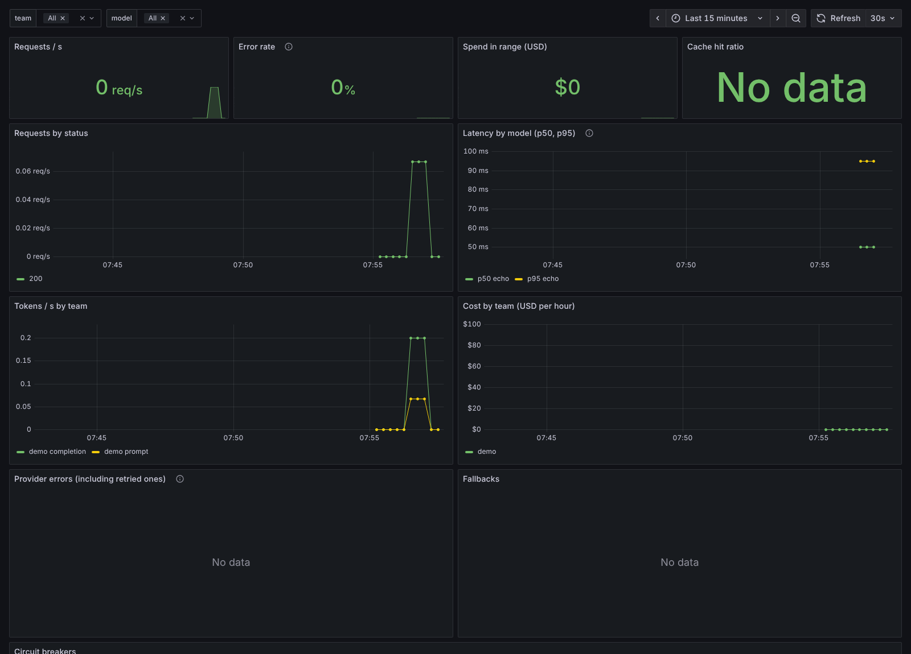

# Observability

Metrics, a Grafana dashboard, logs, traces and alerts. When something goes wrong at 3am, start with the [runbook](runbook.md).

## Metrics

`/metrics` serves Prometheus metrics. It isn't behind a team key, so keep it on an internal network (or turn it off with `LLMOPS_METRICS_ENABLED=false`).

| metric | labels | what it counts |
|---|---|---|
| `llmops_requests_total` | team, model, status | chat requests by outcome (200, 401, 429, 503, ...) |
| `llmops_request_duration_seconds` | model | time to answer, retries and fallbacks included |
| `llmops_tokens_total` | team, model, kind | prompt and completion tokens |
| `llmops_cost_usd_total` | team, model | cost of answered requests |
| `llmops_provider_duration_seconds` | provider, model | time spent on each model, all its tries together |
| `llmops_provider_errors_total` | provider, retryable | failed tries, including ones a retry later hid |
| `llmops_fallbacks_total` | model, fallback | requests that went to a fallback model |
| `llmops_circuit_state` | provider | 0 closed, 1 half-open, 2 open |
| `llmops_cache_lookups_total` | model, result | cache lookups: hit, semantic_hit or miss |
| `llmops_monitor_checks_total` | monitor, result | monitor results on sampled live answers |

Labels only ever contain teams and models from `gateway.yaml`. A request for a model that doesn't exist is counted as `model="unknown"`, so nobody can blow up the number of series by sending random names.

A few queries I find useful:

```promql
# p95 latency per model over 5 minutes
histogram_quantile(0.95, sum by (model, le) (rate(llmops_request_duration_seconds_bucket[5m])))

# share of requests that failed on the provider side
sum(rate(llmops_requests_total{status=~"502|503"}[5m])) / sum(rate(llmops_requests_total[5m]))

# spend per team today
sum by (team) (increase(llmops_cost_usd_total[1d]))

# retries that are hiding a struggling provider
sum by (provider) (rate(llmops_provider_errors_total{retryable="true"}[5m]))
```

Counters reset when the gateway restarts, which `rate()` and `increase()` handle. For exact monthly numbers, use `llmops usage`, which reads the usage database.

## Grafana

Prometheus is at http://localhost:9090, already scraping the gateway, and Grafana at http://localhost:3000 (admin / admin, change it with `GRAFANA_ADMIN_PASSWORD`) opens on the llmops dashboard. The dashboard shows request rate, error rate, latency per model, tokens and cost per team, the cache hit ratio, provider errors, fallbacks and the circuit breakers, with filters for team and model:



The dashboard is a plain JSON file in `deploy/grafana/dashboards/`, so it can be imported into an existing Grafana too.

## Logs and traces

Every request gets an id. If the caller sends an `X-Request-ID` header, the gateway keeps it, otherwise it makes one, and either way it's returned in the response headers. That id is in every log line written while the request runs and on its trace, so when an app reports "this call was slow" you can find exactly what happened.

Logs are one JSON object per line on stderr, ready for Loki, Elasticsearch or CloudWatch (`LLMOPS_LOG_FORMAT=text` for reading them in a terminal). Each request writes one line with its team, model, status and duration:

```json
{"ts": "2026-11-06T07:51:13.347+00:00", "level": "info", "logger": "llmops", "message": "request", "request_id": "demo-1", "method": "POST", "path": "/v1/chat/completions", "status": 200, "duration_ms": 4.8, "team": "demo", "model": "echo"}
```

Traces use OpenTelemetry. Each request is a span, and each call to a provider is a child span with the model and token counts, following the OpenTelemetry GenAI conventions, so a fallback shows up as a failed span followed by one for the backup model. To send them to Jaeger, Tempo or any OTLP collector:

```bash
pip install -e ".[otel]"
LLMOPS_OTEL_ENDPOINT=http://localhost:4318/v1/traces llmops serve
```

Without that setting the spans are still created, but they cost next to nothing and go nowhere. API keys and prompt text are never logged.

## Alerts

`deploy/prometheus/alerts.yml` has Prometheus rules for a gateway that's down, more than 5% of requests failing, a circuit breaker open for 5 minutes, p95 latency above 20s, more than 10% of a model's traffic going to fallbacks, teams getting 429s, and a monitor failing on more than 20% of sampled answers. The compose setup loads them, and CI unit-tests them with `promtool test rules`. Each alert links to its section of the [runbook](runbook.md).
